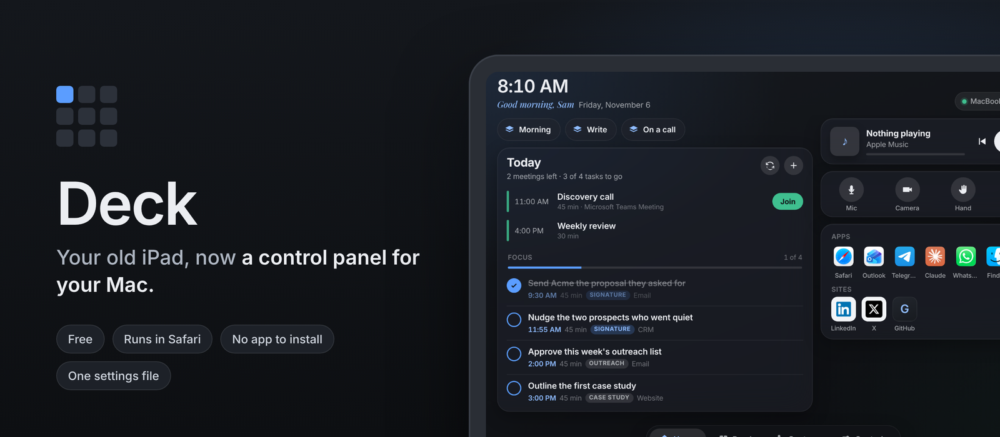
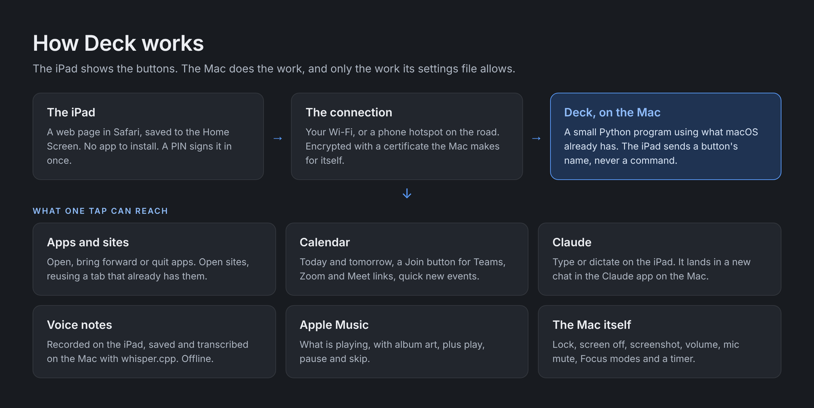
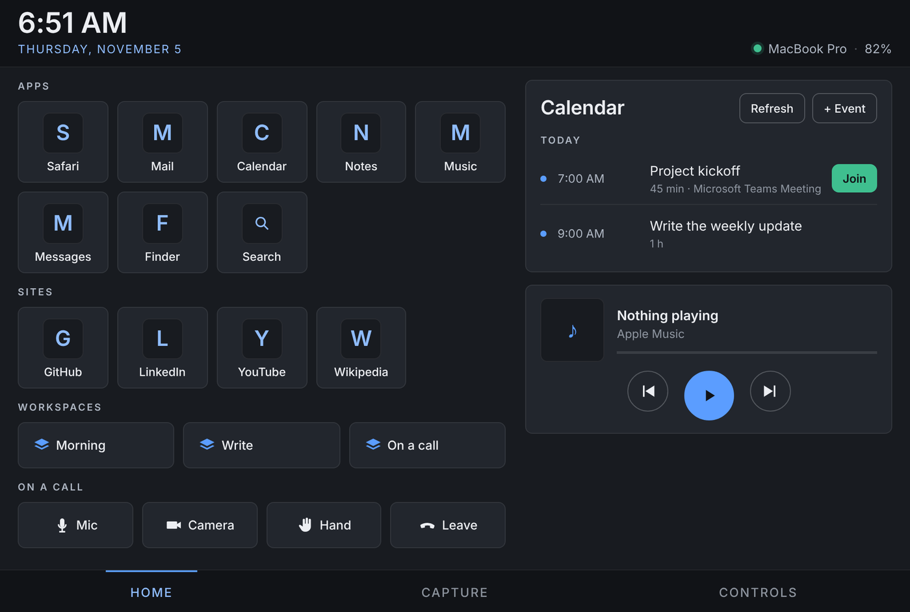
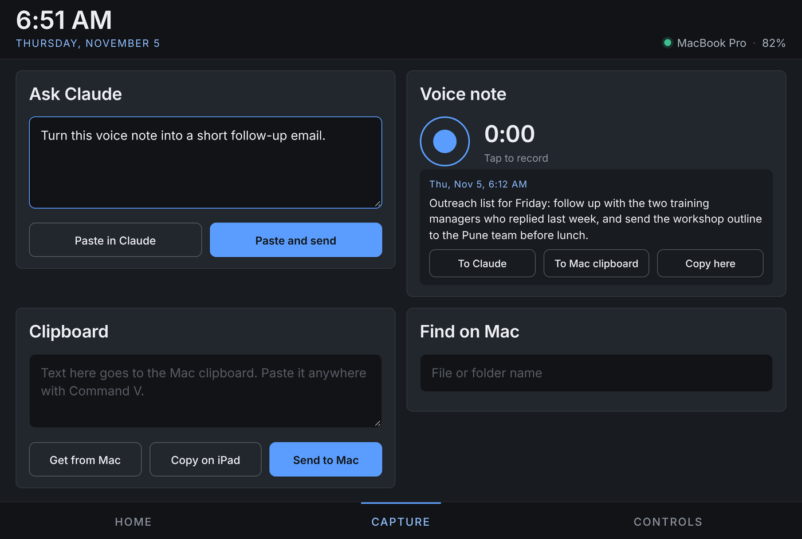
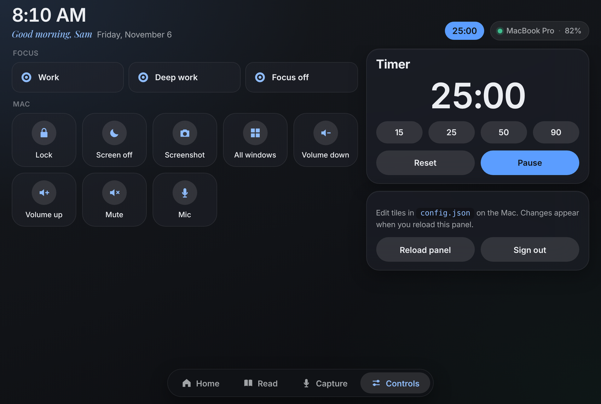
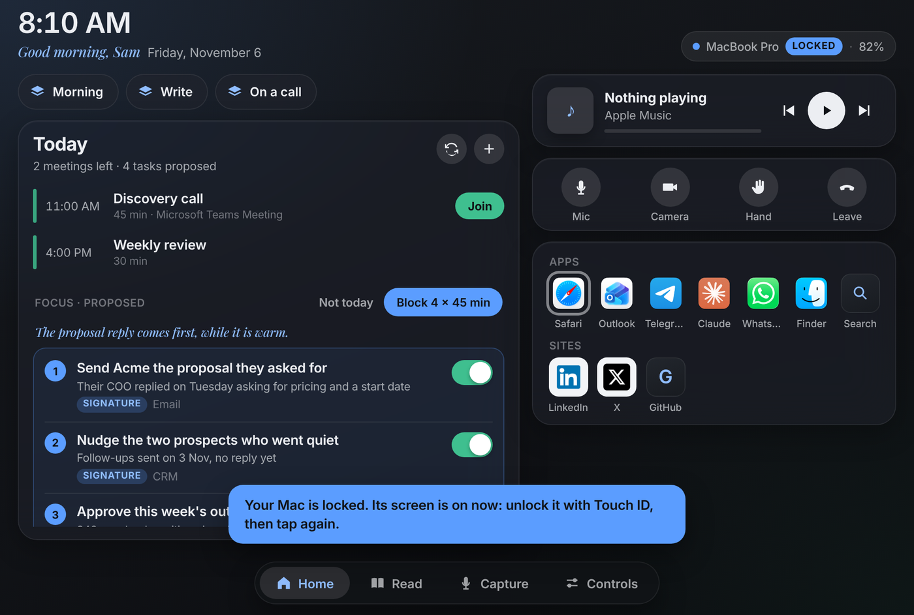

<a href="https://parthans.com/blog/2026/11/05/old-ipad-control-panel-for-my-mac/"></a>

**Turn any iPad into a wireless button panel for your Mac.** Open apps and sites, see your calendar and join meetings, control music, send prompts to Claude and record voice notes, from a web page on the iPad. Free, no app to install, every button set in one file.

[](LICENSE)
[](#what-you-need)
[](#quick-start)
[](#what-you-need)
[](https://github.com/parthans/the-deck-by-parthans/stargazers)

[Quick start](#quick-start) · [What you get](#what-you-get) · [Settings](#settings) · [Security](#how-it-stays-safe) · [Troubleshooting](#troubleshooting) · [Questions](#questions-people-ask)

## Start here

| You want | Go to |
|---|---|
| To see what it looks like | [What you get](#what-you-get) |
| To set it up in 15 minutes | [Quick start](#quick-start) |
| To change the buttons | [Settings](#settings) |
| Your Outlook or Microsoft 365 calendar on it | [Calendar](#calendar) |
| To know what it can and cannot do on your Mac | [How it stays safe](#how-it-stays-safe) |
| To fix "can't open a secure connection" | [Troubleshooting](#troubleshooting) |

## How it works

| | |
|---|---|
| **The iPad** | Shows a web page from your Mac in Safari, saved to the Home Screen so it opens full screen. No app to install. |
| **The connection** | Your Wi-Fi, or a phone hotspot when you are away from home. Encrypted with a certificate the Mac makes for itself. |
| **The Mac** | Runs a small Python program using only what macOS already has. When you tap a button, the iPad sends its name and the Mac does the rest. |



## Quick start

| Step | On | What to do |
|---|---|---|
| **1** | Mac | Download Deck and run the setup script (commands below). It asks for a PIN, makes the certificate and asks macOS for the permissions it needs. |
| **2** | Mac | Start Deck: `bash background.sh on` keeps it running, also after a restart. |
| **3** | iPad | Open the setup address the script prints (`http://your-mac.local:8080`), follow the five steps on that page, then add Deck to the Home Screen. |

```bash
# 1. Download into a folder called deck in your home folder
git clone https://github.com/parthans/the-deck-by-parthans.git ~/deck
cd ~/deck

# 2. Set up: PIN, certificate, calendar helper, optional voice transcription
./setup.sh

# 3. Start in the background, now and at every login
bash background.sh on
```

No git? Download the ZIP from the green **Code** button, unzip it into your home folder, rename the folder to `deck`, and run the same commands from `cd ~/deck` on.

## What you get

| Page | What is on it |
|---|---|
| **Home** | Apps (tap to open; hold, then tap again, to quit), sites (an open tab is reused), workspaces that open several apps and sites at once, call controls, today's calendar with a Join button, Apple Music |
| **Capture** | Ask Claude, voice notes with transcription, clipboard both ways between iPad and Mac, find files on the Mac by name |
| **Controls** | Focus modes, lock, screen off, screenshot, volume, mic mute, your own Shortcuts, a timer |
| **Always** | A PIN screen, a "Locked" label when the Mac is locked, and a message instead of an action when it is |

<table>
<tr>
<td width="50%"><a href="docs/home.png"></a><br><em>Home. On your Mac, app buttons show each app's own icon.</em></td>
<td width="50%"><a href="docs/capture.png"></a><br><em>Capture. Prompts go to Claude, notes are transcribed on the Mac.</em></td>
</tr>
<tr>
<td width="50%"><a href="docs/controls.png"></a><br><em>Controls. The timer also shows in the header on every page.</em></td>
<td width="50%"><a href="docs/locked.png"></a><br><em>Locked Mac. Deck wakes the screen and waits for you.</em></td>
</tr>
</table>

## What you need

| | |
|---|---|
| **Mac** | A recent version of macOS. Built and used on an Apple silicon MacBook Pro. |
| **Command Line Tools** | `xcode-select --install`. Gives you Python 3 and the Swift compiler for the calendar helper. Nothing else to install. |
| **iPad** | Any iPad with a current Safari. Built on a 9.7-inch sixth-generation iPad, held sideways. |
| **Same network** | The iPad and the Mac on the same Wi-Fi or hotspot. Deck is not reachable from the internet. |
| **Optional** | [Homebrew](https://brew.sh), only for voice transcription. Setup installs `whisper-cpp` and a 150 MB speech model if you say yes. |
| **Optional** | The [Claude](https://claude.ai/download) desktop app, for the Ask Claude box. |

## Settings

Every button lives in `config.json`, which setup creates from [`config.example.json`](config.example.json). Edit it while Deck runs, then tap **Reload panel** on the Controls page. Your `config.json` is never committed: it holds your PIN.

Each button has an `id`, a `label` and a `do`:

| `do` | What it does | Example |
|---|---|---|
| `open_app` | Opens or brings forward an app. Hold the button, then tap it again, to quit the app. | `{ "open_app": "Notes" }` |
| `open_app` + `or_url` | Opens the app if you have it, the site if you do not | `{ "open_app": "Slack", "or_url": "https://app.slack.com" }` |
| `open_url` | Opens a site, reusing a tab that already has it | `{ "open_url": "https://github.com", "browser": "Safari" }` |
| `shortcut` | Runs a shortcut from the Shortcuts app by name | `{ "shortcut": "Start my day" }` |
| `keys` | Presses keys, optionally in a given app first | `{ "keys": "cmd+shift+m", "app": "Microsoft Teams" }` |
| `steps` | Runs other buttons in order, by id | `{ "steps": ["mail", "calendar", "focus-work"] }` |
| `builtin` | A ready-made action | `lock`, `display_sleep`, `screenshot`, `mission_control`, `spotlight`, `vol_up`, `vol_down`, `mute_toggle`, `mic_toggle` |

Buttons go into sections: `apps`, `sites`, `workspaces`, `call`, `focus`, `system` and `shortcuts`. An empty section is hidden.

A button can have its own picture: `"icon": "icons/my-site.png"`. Put the file in an `icons` folder inside `deck`. Use this for sites behind a login, whose icons Deck cannot fetch.

### Calendar

Deck reads the calendars your Mac already syncs.

| Setting | Meaning |
|---|---|
| `"source": "all"` | Every calendar on the Mac (the default) |
| `"source": "outlook"` | Only Microsoft 365 or Exchange calendars |
| `"match": ["Work"]` | Extra account names to count as Outlook, if yours is named differently |
| `"days": 2` | Today and tomorrow |
| `"only_calendars": ["Calendar"]` | Only calendars with these names |
| `"add_to_calendar": "Calendar"` | Where **+ Event** puts new events |

For Microsoft 365: System Settings, Internet Accounts, Add Account, **Microsoft Exchange** (there is no separate Microsoft 365 option), sign in, and switch on Calendars. Calendar settings take effect on the next refresh. If you change `tools/agenda.swift`, rebuild the helper by running `./setup.sh` again.

### Focus modes

The Focus buttons run three shortcuts you make once in the Shortcuts app: `Deck Focus Work`, `Deck Focus Deep` and `Deck Focus Off`, each with one **Set Focus** action.

### Call buttons

The example uses Microsoft Teams key combinations. For another app, change `app` and `keys` to that app's own shortcuts.

## Running in the background

```bash
bash ~/deck/background.sh on       # start now and at every login, no window
bash ~/deck/background.sh restart  # after changing server.py
bash ~/deck/background.sh status   # is it running?
bash ~/deck/background.sh off      # stop, and do not start at login
```

Messages go to `~/deck/deck.log`. While you try it out, `deck.command` runs Deck in a Terminal window instead.

If you ran Deck from Terminal before, macOS sees the background version as a separate program and asks again for the permissions below, this time for Python.

| Permission | Why | Where |
|---|---|---|
| Accessibility | Pressing keys (lock, Claude, call buttons) | Privacy and Security, Accessibility |
| Automation | Controlling Safari, Chrome, Music and System Events | Asked the first time each is used |
| Calendars | Reading and adding events | Asked the first time |
| Screen Recording | The Screenshot button | Privacy and Security, Screen Recording |

## How it stays safe

A page that can open apps and press keys on your Mac needs limits. These are Deck's:

- **The iPad sends names, not commands.** It can only ask for a button listed in `config.json`. Nothing the iPad sends is run as a command.
- **A PIN signs each device in once.** After five wrong tries, Deck makes you wait, longer each time.
- **The connection is encrypted** with a certificate authority made on your Mac during setup. Its private key never leaves the `certs` folder.
- **Local only.** Deck listens on your network. Do not forward its port on your router or put it on the internet.
- **A locked Mac stays locked.** If the Mac is locked, buttons that open or type things are refused, and the Mac's screen wakes so you can unlock it. Music, volume, mute and lock still work.
- **A stuck connection cannot freeze it.** Any connection that does not finish within 10 seconds is dropped.

To report a security problem, see [SECURITY.md](SECURITY.md).

## Troubleshooting

| | Problem | Fix |
|---|---|---|
| 🔁 | iPad says it cannot open a secure connection | Run `bash ~/deck/background.sh restart`. If it keeps happening, check that the Mac is awake: Deck cannot answer while the Mac sleeps. To keep it awake on power, System Settings, Battery, Options, "Prevent automatic sleeping on power adapter when the display is off". |
| ⚠️ | A button does nothing | Look at the last lines of `~/deck/deck.log`. Usually a missing permission from the table above. |
| ⚠️ | Calendar says no Outlook calendar found | The message lists the calendar accounts the Mac has. Add the right name to `"match"`, or check the account in Internet Accounts with Calendars on. |
| ⚠️ | Voice notes do not record | Safari only allows the microphone on a trusted secure page. Repeat the certificate steps on `http://your-mac.local:8080`. |
| 🍎 | macOS will not open `deck.command` | System Settings, Privacy and Security, **Open Anyway**. Or run `xattr -c ~/deck/*` once. |
| 🍎 | Voice notes fail to save in background mode | macOS keeps background programs out of Documents, Desktop and Downloads. Keep `"folder"` somewhere else, like the default `~/Voice Notes`. |
| ⚠️ | A site opens a new tab every time | Allow Python to control Safari or Chrome when macOS asks. Deck needs that to look through open tabs. |

## Questions people ask

**Why not Sidecar?** Sidecar makes the iPad a second screen. Deck makes it a panel of buttons. They work well together: a newer iPad as a Sidecar screen, an older one as Deck.

**Does it work away from home?** Yes, if the iPad and the Mac are on the same network. A phone hotspot works: join both to it.

**Can someone else on my Wi-Fi use it?** Not without your PIN. Deck also refuses anything that is not a button in your settings file.

**Does it cost anything?** No. It uses Python and Swift from Apple's free Command Line Tools, and whisper.cpp, which is free and runs on your Mac.

**Do I need Claude?** No. Without the Claude app, the Ask Claude box does nothing and everything else works.

**Does it work on Windows or with an Android tablet?** The server needs macOS. The panel is a web page, so any tablet browser can show it.

**Can I change the look?** Yes. All colours are a few lines at the top of `static/app.css`.

## The story

Partha Srinivasan built Deck in an afternoon to give an old iPad a second life beside his MacBook, then spent the evening fixing what only daily use shows up. He wrote up the build, including what broke, in [My old iPad is now the control panel for my Mac](https://parthans.com/blog/2026/11/05/old-ipad-control-panel-for-my-mac/). Deck was built with [Claude](https://claude.ai), Anthropic's AI model: Partha set the requirements, made the calls and tested it, and Claude wrote the code.

## Contributing

Issues and pull requests are welcome. Keep Deck free of packages to install: the server uses only Python's standard library, and the panel uses no framework. Test on a real iPad before opening a pull request, and say which iPad and macOS you used.

## Licence

[MIT](LICENSE). Use it, change it and share it, including commercially, as long as the licence and copyright notice stay with it.

<sub>Made by <a href="https://parthans.com">Partha Srinivasan</a>.</sub>
